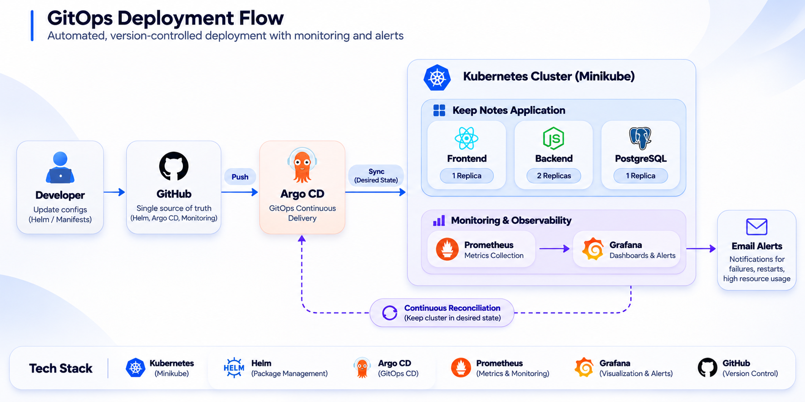

# Keep Notes — Kubernetes GitOps Deployment

A local Kubernetes deployment project demonstrating container orchestration, Helm-based deployments, GitOps automation, and application monitoring using Prometheus and Grafana.

<p align="center">
  
</p>

## Overview

This project demonstrates how to deploy and manage a multi-tier application on Kubernetes using Helm and Argo CD.

Application and infrastructure configurations are maintained in GitHub. Argo CD continuously monitors the configured Git repositories, compares the desired state with the live Kubernetes cluster, and synchronizes resources.

The project also implements a monitoring stack using Prometheus and Grafana to observe Kubernetes workloads, visualize metrics, and configure email alert notifications.

## Technology Stack

| Technology | Purpose |
|---|---|
| Kubernetes | Container orchestration |
| Minikube | Local Kubernetes environment |
| Docker | Container runtime |
| Helm | Kubernetes package management and templating |
| Argo CD | GitOps continuous delivery |
| Prometheus | Metrics collection and monitoring |
| Grafana | Dashboards and alerting |
| kube-state-metrics | Kubernetes resource metrics |
| Git & GitHub | Version control and configuration management |

## Architecture Components

| Component | Technology | Purpose |
|---|---|---|
| GitOps | Argo CD | Synchronizes desired configurations from Git |
| Packaging | Helm | Templates and manages Kubernetes resources |
| Orchestration | Kubernetes | Runs application and monitoring workloads |
| Application frontend | Kubernetes Deployment | Serves the Keep Notes interface |
| Application backend | Kubernetes Deployment | Runs application backend services |
| Database | PostgreSQL | Persistent application data storage |
| Metrics collection | Prometheus | Collects and stores monitoring metrics |
| Resource metrics | kube-state-metrics | Exposes Kubernetes object state |
| Visualization | Grafana | Displays monitoring dashboards |
| Alerting | Grafana Alerting | Evaluates alert rules and sends notifications |

## Repository Structure

```text
keep-notes-gitops/
│
├── argocd/
│   ├── keep-notes.yaml
│   ├── grafana-application.yaml
│   └── prometheus-application.yaml
│
├── docs/
│   └── images/
│       └── gitops-architecture.png
│
├── helm/
│   └── keep-notes/
│       ├── Chart.yaml
│       ├── values.yaml
│       └── templates/
│           ├── backend-deployment.yaml
│           ├── backend-service.yaml
│           ├── configmap.yaml
│           ├── frontend-deployment.yaml
│           ├── frontend-service.yaml
│           ├── postgres-deployment.yaml
│           ├── postgres-service.yaml
│           ├── pvc.yaml
│           └── secret.yaml
│
├── monitoring/
│   ├── prometheus/
│   │   └── values.yaml
│   │
│   └── grafana/
│       ├── Chart.yaml
│       ├── values.yaml
│       ├── templates/
│       ├── dashboards/
│       ├── alert-rules/
│       ├── contact-points/
│       └── notification-policies/
│
└── README.md
```

## Deployment Architecture

The deployment follows a GitOps-based workflow:

1. Deployment configurations and Helm charts are maintained in GitHub.
2. Configuration changes are committed and pushed to the repository.
3. Argo CD monitors the configured Git repositories and branches.
4. Argo CD compares the desired configuration with the live Kubernetes resources.
5. Helm charts are rendered into Kubernetes manifests.
6. Argo CD synchronizes the desired resources with the Kubernetes cluster.
7. Kubernetes runs the application and monitoring workloads.

## Kubernetes Resources

### Keep Notes Application

| Component | Replicas | Purpose |
|---|---:|---|
| Frontend | 1 | Application user interface |
| Backend | 2 | Application backend services |
| PostgreSQL | 1 | Database |

The application Helm chart includes:

- Kubernetes Deployments and Services.
- ConfigMaps for application configuration.
- Secrets for sensitive configuration.
- PersistentVolumeClaim for PostgreSQL storage.
- Configurable replica counts and container resources.

### Persistent Storage

Persistent storage is configured for application and monitoring workloads.

| Component | PVC | Capacity |
|---|---|---:|
| PostgreSQL | keep-notes-postgres-pvc | 1Gi |
| Prometheus | prometheus-server | 5Gi |
| Grafana | grafana-data-fresh | 2Gi |

## Helm Configuration

Helm is used to package and configure Kubernetes deployments.

The Keep Notes application chart is located at:

`helm/keep-notes/`

The Grafana chart is maintained at:

`monitoring/grafana/`

Prometheus uses the official Prometheus Community Helm chart, with its configuration maintained in:

`monitoring/prometheus/values.yaml`

### Helm Validation

Validate the Keep Notes chart:

```bash
helm lint helm/keep-notes
```

Render the application manifests:

```bash
helm template keep-notes helm/keep-notes
```

Validate the Grafana chart:

```bash
helm lint monitoring/grafana
```

Render Grafana manifests:

```bash
helm template grafana monitoring/grafana
```

## GitOps with Argo CD

Argo CD is used to implement GitOps-based continuous delivery.

The project contains three Argo CD Applications:

| Application | Source | Purpose |
|---|---|---|
| Keep Notes | GitHub repository | Application deployment |
| Grafana | GitHub repository | Monitoring dashboard and alerting |
| Prometheus | Official Helm chart + GitHub values | Metrics collection |

### GitOps Workflow

1. Update deployment configuration in the Git repository.
2. Commit and push changes to GitHub.
3. Argo CD detects changes in the configured source.
4. Argo CD compares Git with the live cluster.
5. Changes are synchronized to Kubernetes.
6. Argo CD continuously reconciles resources according to the configured sync policies.

### Application Configuration

Argo CD Application manifests are maintained in:

`argocd/`

- `keep-notes.yaml` — Keep Notes application deployment.
- `grafana-application.yaml` — Grafana monitoring deployment.
- `prometheus-application.yaml` — Prometheus deployment using a multi-source Application.

Grafana and Prometheus use manual synchronization with pruning disabled to protect existing monitoring resources and persistent storage.

## Monitoring and Observability

The monitoring stack consists of Prometheus, kube-state-metrics, and Grafana.

### Prometheus

Prometheus collects and stores metrics used to monitor Kubernetes workloads.

Configuration highlights:

- Official Prometheus Community Helm chart.
- kube-state-metrics integration.
- Persistent storage configured with a 5Gi PVC.
- Resource requests and limits configured.
- Grafana configured to use Prometheus as its data source.

### Grafana

Grafana provides visualization and alerting for the monitoring stack.

Configuration highlights:

- Custom Keep Notes Kubernetes Monitoring dashboard.
- Prometheus data source integration.
- Provisioned dashboards and alert rules.
- Email contact point configuration.
- Notification policies.
- Persistent storage configured with a 2Gi PVC.

## Dashboard and Alerting

The project includes a custom Grafana dashboard:

**Keep Notes - Kubernetes Monitoring**

The dashboard contains 10 monitoring panels covering application and Kubernetes workload health.

### Alert Rules

A total of 10 alert rules are configured.

| Workload | Alert |
|---|---|
| Backend | Replicas unavailable |
| Backend | Pod restarts |
| Backend | High CPU utilization |
| Backend | High memory utilization |
| Frontend | Replicas unavailable |
| Frontend | Pod restarts |
| Frontend | High CPU utilization |
| Frontend | High memory utilization |
| PostgreSQL | Pod restarts |
| PostgreSQL | Pod unavailable |

### Email Notifications

Grafana Alerting is configured with:

- Email contact point.
- Notification policy.
- Provisioned alert rules.
- SMTP configuration through Kubernetes Secrets.

Sensitive SMTP credentials and the alert recipient email are stored outside the Git repository.

## Running Locally

### Prerequisites

- Docker
- Minikube
- kubectl
- Helm
- Argo CD

The project is deployed locally using a Minikube Kubernetes cluster.

### Verify Kubernetes Cluster

```bash
kubectl --context keep-notes get nodes
```

### Check Argo CD Applications

```bash
kubectl --context keep-notes get applications -n argocd
```

### Check Kubernetes Workloads

```bash
kubectl --context keep-notes get pods -n monitoring
```

```bash
kubectl --context keep-notes get pods
```

### Check Persistent Storage

```bash
kubectl --context keep-notes get pvc -A
```

### Access Grafana

Start port forwarding:

```bash
kubectl --context keep-notes port-forward -n monitoring svc/grafana 3002:3000
```

Open Grafana:

`http://localhost:3002`

## Security Considerations

- Sensitive credentials are stored in Kubernetes Secrets rather than committed to Git.
- Grafana SMTP credentials are supplied through Kubernetes Secrets.
- Alert recipient email is supplied through a Kubernetes Secret.
- Persistent storage is configured for database and monitoring workloads.
- Resource requests and limits are configured for monitoring workloads.
- Avoid committing passwords, tokens, private keys, and other sensitive information.

## Project Status

| Area | Status |
|---|---|
| Kubernetes application deployment | Deployed |
| Helm chart validation | Passed |
| Keep Notes Argo CD Application | Synced / Healthy |
| Grafana Argo CD Application | Synced / Healthy |
| Prometheus Argo CD Application | Synced / Healthy |
| Prometheus metrics collection | Configured |
| Grafana dashboard | Provisioned |
| Alert rules | 10 configured |
| Email contact point | Configured and test email sent |
| Persistent monitoring storage | Bound |

## Environment

This project is developed and deployed locally using Minikube.

It demonstrates Kubernetes deployment, Helm configuration management, GitOps workflows, monitoring, and alerting without requiring AWS or paid cloud infrastructure.

---

**Author:** Harsha S

**Project:** Keep Notes GitOps Deployment
