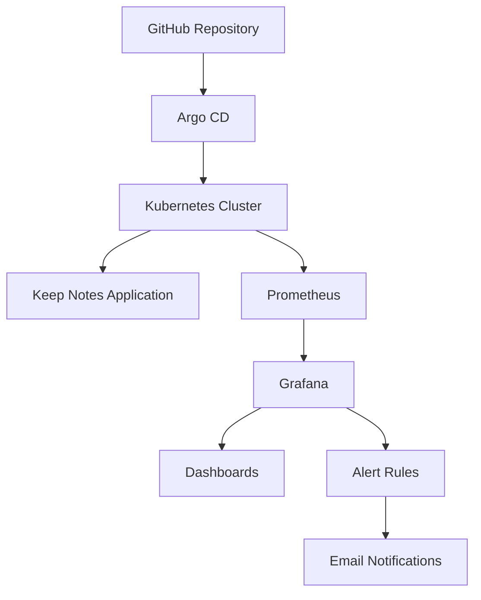

# Keep Notes — Kubernetes GitOps Deployment

A local Kubernetes deployment project demonstrating container orchestration, Helm-based deployments, GitOps automation, and application monitoring using Prometheus and Grafana.

## Overview

This project demonstrates how to deploy and manage a multi-tier application on Kubernetes using Helm and Argo CD.

The infrastructure and deployment configurations are maintained in GitHub. Argo CD monitors the repository and reconciles Kubernetes resources based on the desired configuration.

The project also includes a monitoring stack using Prometheus and Grafana to observe Kubernetes workloads and configure alerting.

## Architecture



## Tech Stack

| Technology | Purpose |
|---|---|
| Kubernetes | Container orchestration |
| Minikube | Local Kubernetes cluster |
| Docker | Container runtime |
| Helm | Kubernetes package management |
| Argo CD | GitOps continuous delivery |
| Prometheus | Metrics collection |
| Grafana | Monitoring and visualization |
| Git & GitHub | Version control and configuration management |

## Project Structure

```text
keep-notes-gitops/
│
├── argocd/
│   ├── grafana-application.yaml
│   ├── prometheus-application.yaml
│   └── keep-notes.yaml
│
├── helm/
│   └── keep-notes/
│       ├── Chart.yaml
│       ├── values.yaml
│       └── templates/
│
├── monitoring/
│   ├── prometheus/
│   │   └── values.yaml
│   │
│   └── grafana/
│       ├── Chart.yaml
│       ├── values.yaml
│       ├── templates/
│       ├── dashboards/
│       ├── alert-rules/
│       ├── contact-points/
│       └── notification-policies/
│
└── README.md
```

## Deployment Workflow

1. Application deployment configurations are maintained using Helm charts.
2. Helm templates define Kubernetes Deployments, Services, ConfigMaps, Secrets, and PersistentVolumeClaims.
3. Configuration changes are committed and pushed to GitHub.
4. Argo CD monitors the repository and compares the desired state with the live Kubernetes resources.
5. Argo CD synchronizes approved changes to the cluster.

## Monitoring

### Prometheus
- Collects Kubernetes and workload metrics.
- Uses kube-state-metrics for Kubernetes resource metrics.
- Stores metrics using persistent storage.
- Configured with resource requests and limits.

### Grafana
- Visualizes metrics collected by Prometheus.
- Includes a Keep Notes Kubernetes Monitoring dashboard.
- Contains alert rules for backend, frontend, and PostgreSQL workloads.
- Configured with email contact points and notification policies.

### Alerting Coverage

- Backend and frontend replica availability
- Pod restarts
- CPU utilization
- Memory utilization
- PostgreSQL pod availability and restarts

## GitOps Applications

The following applications are configured in Argo CD:

| Application | Source | Status |
|---|---|---|
| Keep Notes | GitHub Helm chart | Managed by Argo CD |
| Grafana | GitHub Helm chart | Synced / Healthy |
| Prometheus | Official Prometheus Helm chart + GitHub values | Synced / Healthy |

## Running Locally

Prerequisites:

- Docker
- Minikube
- kubectl
- Helm
- Argo CD

Check the Kubernetes cluster:

```bash
kubectl get nodes
```

Check Helm deployments:

```bash
helm list -A
```

Check Argo CD applications:

```bash
kubectl get applications -n argocd
```

Check monitoring workloads:

```bash
kubectl get pods -n monitoring
```

Access Grafana locally:

```bash
kubectl port-forward -n monitoring svc/grafana 3002:3000
```

Open:

```text
http://localhost:3002
```

## Project Goals

- Practice Kubernetes application deployment.
- Implement Helm-based configuration management.
- Understand GitOps workflows using Argo CD.
- Deploy and configure Prometheus and Grafana.
- Implement persistent storage for monitoring services.
- Configure workload monitoring and alert notifications.
- Manage deployment configuration through GitHub.

## Environment

This project is developed and deployed locally using Minikube. It does not require AWS or paid cloud infrastructure.

---

**Author:** Harsha S

**Project:** Keep Notes GitOps Deployment